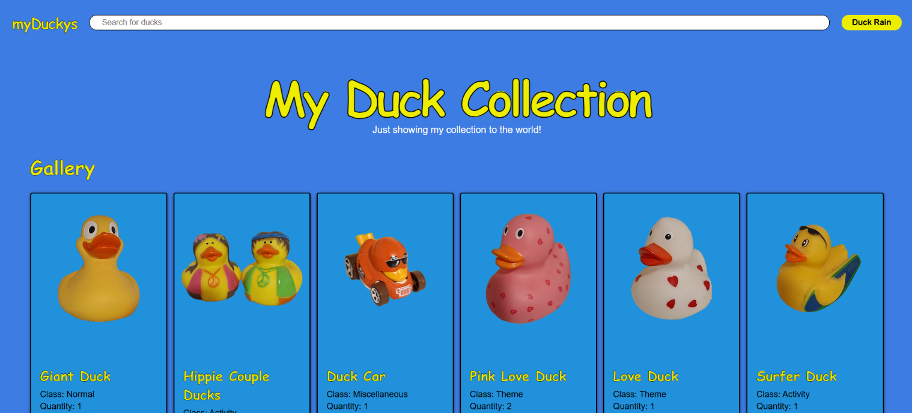

# myDuckys🦆 - Rubber Duck Collection
>Website developed for the Assignment 2 of the Web Development class of the Design and Multimedia Masters at the University of Coimbra

## Purpose
The purpose of **myDuckys** is to showcase my unique rubber duck collection in a digital catalog. The website displays each duck followed by it's name, class, date of acquirement, quantity and small description.

## Style Choice
The aesthetic follows a "goofy" visual style with round fonts, such as *Fredoka* and *Poppins*, bright colors and a **Duck Rain** button to match the uncommon nature of this collection.

## Random Useless Fact API
I integrated the **Random Useless Fact API** (`https://uselessfacts.jsph.pl/`) to display one on the footer, to also add to the randomness of the website.
